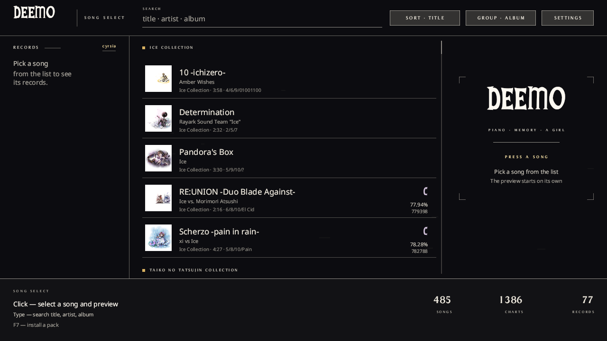
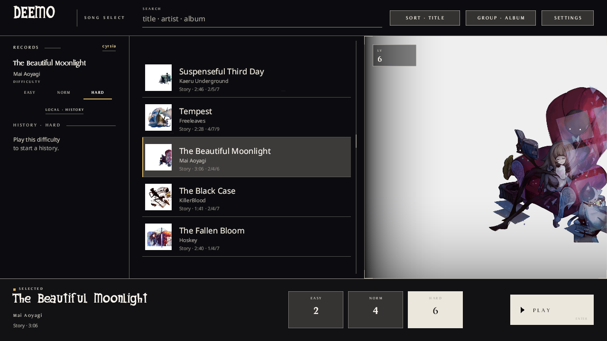
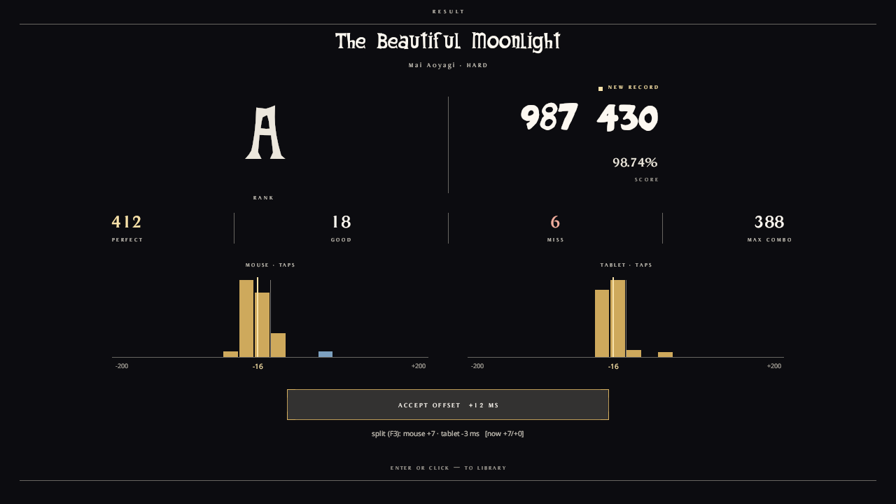

# deemo

A Deemo-style rhythm game for PC (Linux): a song library with previews and records,
falling-note play at the judge line, and a result screen with a tap-timing
histogram.

A chart server can be connected for uploading and downloading charts.

## Two cursors

The game is played with two cursors at once — the mouse and a pen on a graphics
tablet, each judged separately.

A graphics tablet is needed to control the left cursor. Tablet support is at an
early stage: only a few models are mapped so far, and the list keeps growing —
see [TABLETS.md](TABLETS.md).



## Install from release

Download `deemo-0.1.1-linux-x86_64.tar.gz` from the
[releases page](https://github.com/x2d7/deemo/releases), then:

```sh
tar xzf deemo-0.1.1-linux-x86_64.tar.gz
cd deemo-0.1.1
./deemo
```

The game keeps its state in `data/` next to the binary — settings, results,
replays, imported packs. Run it from the extracted directory (the paths are
relative to the working directory).

Verify the download:

```sh
sha256sum -c SHA256SUMS
```

## Run from source

```sh
scripts/build.sh            # or: cd native && cargo build --release
./native/target/release/deemo
```

Run it from the repository root so that `data/` is found: the game resolves
`data/fonts/`, `data/sprites/`, `data/imported/` and its own state files
relative to the working directory.

The build needs edition 2024, so Rust 1.85 or newer.

## Adding charts

The library is built from `data/library.json` plus every pack installed under
`data/imported/<id>/`. A pack is a folder with a `pack.json` at its root and its
charts, audio and cover inside. There are four ways to get one in:

1. **Inbox folder.** Drop a `.deemopack` (or `.zip`, or an unpacked pack folder)
   into `data/inbox/`. The folder is polled once a second; installed packs move
   to `data/inbox/_installed/`, failures to `data/inbox/_failed/`.
2. **File picker.** Press `F7` anywhere in the game, or use Settings →
   *Install pack from file…*. This opens the native dialog (`kdialog`, else
   `zenity`), which also works on Wayland where window drag & drop does not.
3. **Download all packs.** Settings → *Download all packs* fetches the vanilla
   bundle (`/api/bundle/vanilla.zip`) from the chart server at
   `http://199.247.22.102`, unpacks it into `data/imported/`, and skips packs
   that are already installed. Progress and a cancel (`Esc`) are shown in the
   settings row.
4. **Manually.** Unzip a `.deemopack` into `data/imported/<id>/` yourself and
   press `F5` in the library to rescan.



## Controls

Library (song select):

| Input | Action |
| --- | --- |
| typing | search by title, artist or album |
| click a song | select it, start the preview |
| `Enter` / click `PLAY` | play the selected chart |
| `Home` / `End` | jump to the first / last song |
| `PageUp` / `PageDown` | scroll one page |
| mouse wheel | scroll the list |
| drag the scrollbar | scrub the list |
| `F1` | Settings |
| `F5` | rescan `data/imported/` |
| `F7` | install a pack from a file |
| `F11` | fullscreen |
| `Esc` | clear the search, then the selection, then quit |

Play:

| Input | Action |
| --- | --- |
| `Space` | pause / resume |
| `↑` / `↓` | note speed (0.5–9.5) |
| `G` | toggle note guides |
| `F2` | save the raw input of the run to `data/replays/` |
| `F11` | fullscreen |
| `Esc` | back to the library |
| `S` (while paused) | open Settings |

Result:

| Input | Action |
| --- | --- |
| `Enter` / `Esc` | back to the library |
| `F3` | apply the recommended split offsets (mouse / tablet) and save them |

Settings:

| Input | Action |
| --- | --- |
| `↑` / `↓` / `Tab` | move between rows |
| `←` / `→` | change a value |
| `Enter` / space / click | toggle or activate |
| `Esc` | close (back) |

The menu scroll speed itself is adjusted with `Ctrl+[` / `Ctrl+]`.



## Licence

The code is released into the public domain — [Unlicense](LICENSE). Do what you
want with it.

That dedication covers the code, not the bundled assets. `data/sprites/` is
Deemo game art, and two of the fonts in `data/fonts/` are decorative faces from
the Deenote Deemo asset set, included for a fan project; Noto Sans is OFL. See
[THIRD_PARTY.md](THIRD_PARTY.md) and
[data/fonts/README.md](data/fonts/README.md). If a decorative font is missing
the game simply falls back to Noto Sans and still starts.

## Status

Not affiliated with Rayark or the Deemo authors. Charts, audio and covers are
not distributed with the game.
